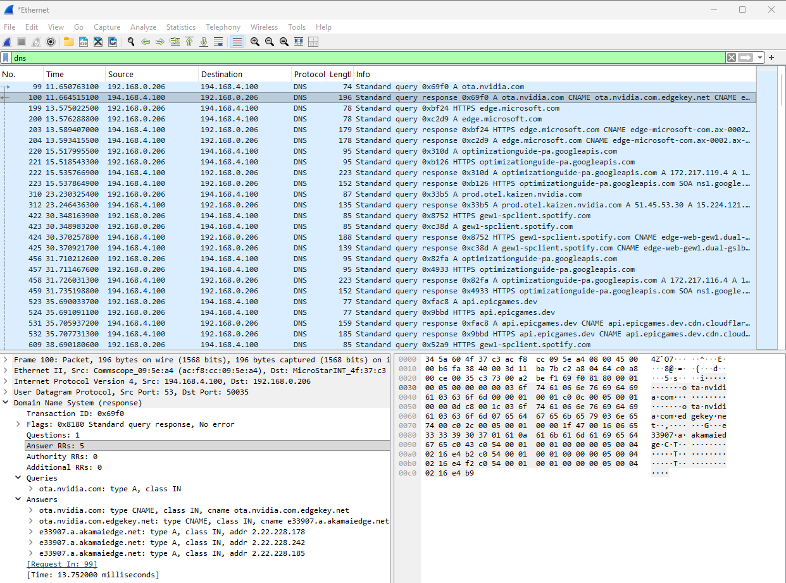
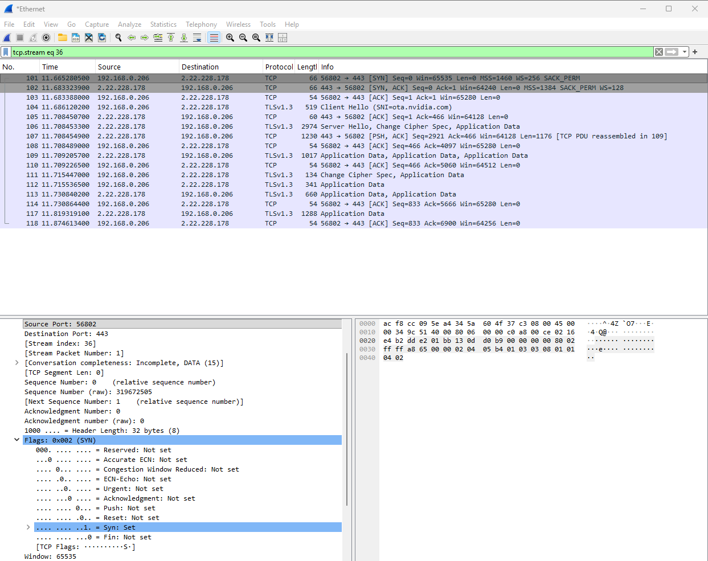
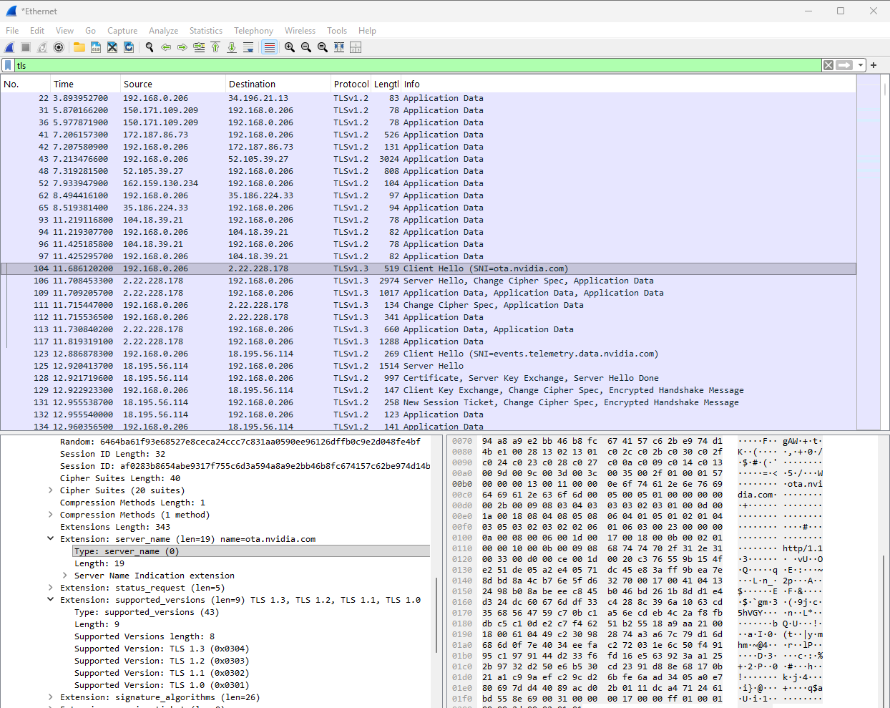
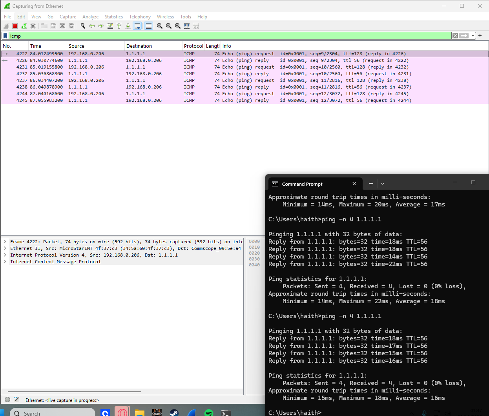
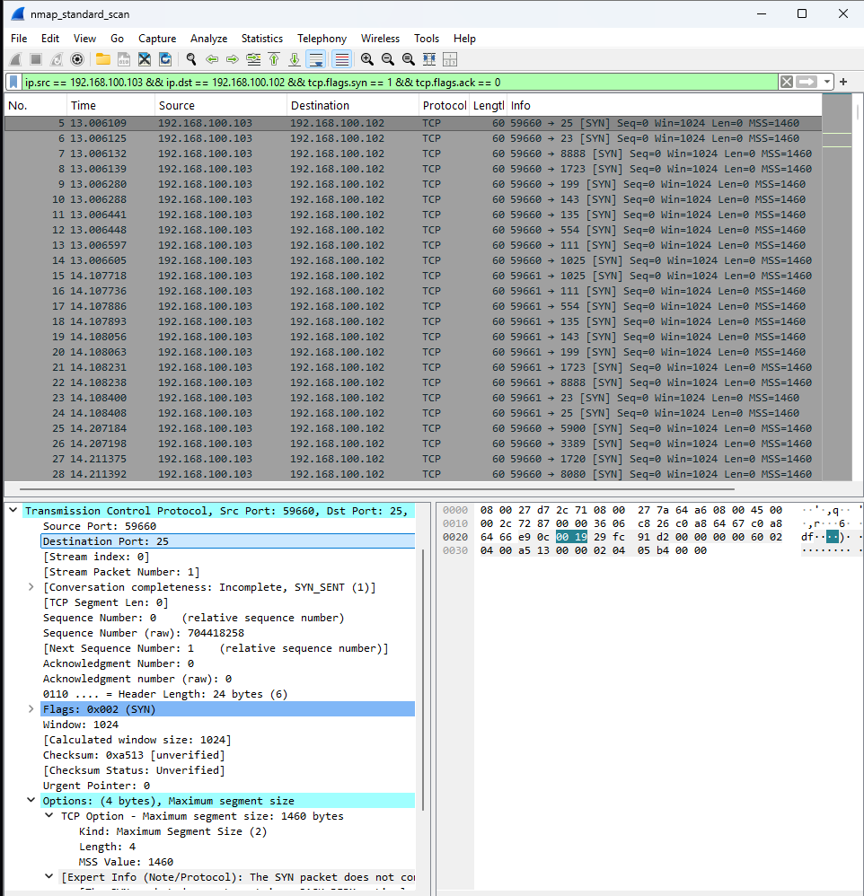
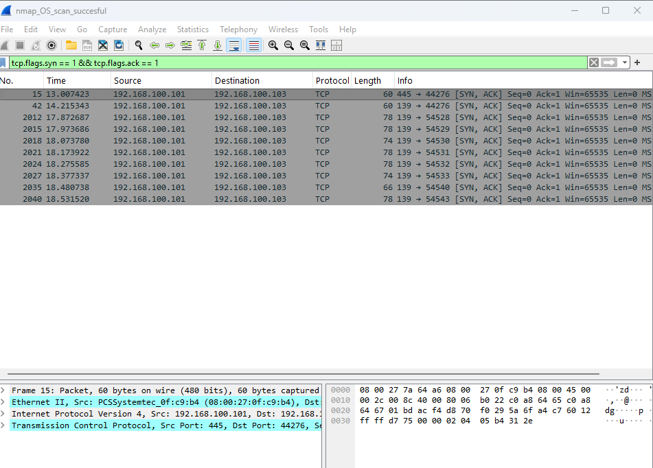
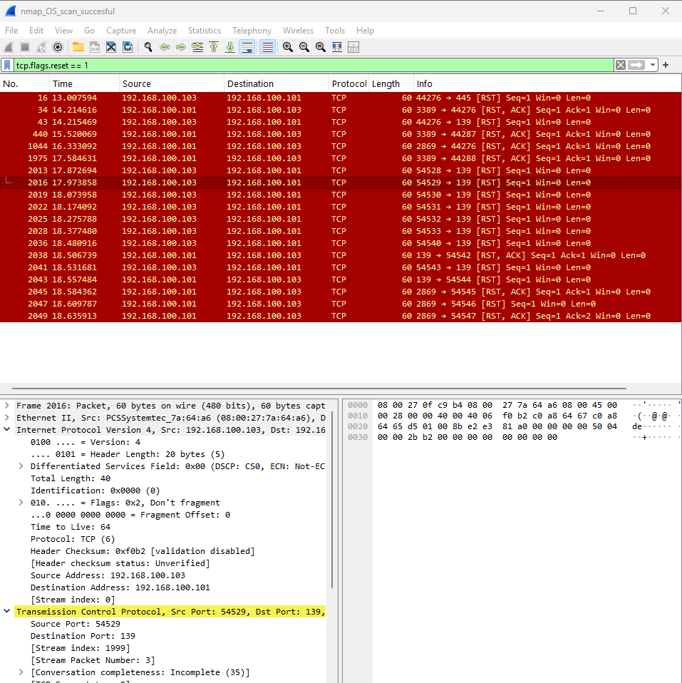
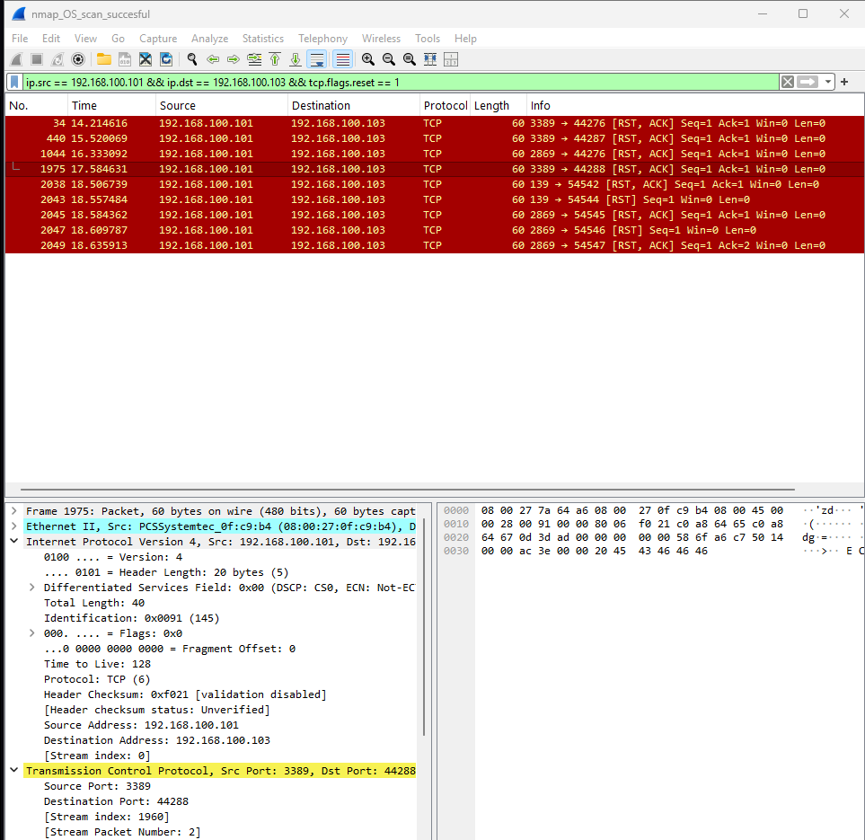

# wireshark-traffic-analysis
Wireshark project exploring DNS, TCP, TLS, ICMP and Nmap port-scan captures.

## What I wanted to learn 

- How to capture packets in Wireshark.
- How DNS queries and responses work
- How to recognise a TCP three-way handshake
- What information is visible in a TLS Client Hello
- How ICMP ping requests and replies appear in a capture
- How SYN, SYN-ACK and RST packets can help when looking at a port scan

## Tools used
- Windows
- Wireshark
- Npcap for live packet capture
- Windows Command prompt
- Wireshark's sample packet captures, including Nmap examples

## 1. DNS
I used the `dns` display filter to find DNS packets. One of the queries I looked at was for `ota.nvidia.com`. I expanded the response and saw CNAME records and IPv4 addresses.

This helped me understand that DNS traffic can show which domain a computer is looking up and what answers the DNS server returns. A normal DNS lookup on its own isn't suspicious.

## 2. TCP handshake

I used this filter to find initial TCP SYN packets: 
`tcp.flags.syn == 1 && tcp.flags.ack == 0`

1. **SYN** - the client starts the connection
2. **SYN-ACK** - The other side responds
3. **ACK** - the client acknowledges the response

Seeing all three packets showed that this connection's TCP handshake completed. A SYN packet by itself only shows an attempt to connect.

## 3. TLS
I used the `tls` filter and inspected a Client Hello. The packet showed the SNI hostname ota.nvidia.com and a supported-versions extension. TLS application-data packets were also visible.

This showed me that encrypted connections can still expose some information, such as a hostname in the Client Hello, depending on the protocol and configuration. The supported versions listed by the client are versions it can use; they do not mean every version was chosen. I didn't decrypt the application data.

## 4. ICMP ping 
While Wireshark was capturing on Ethernet, I ran: 

`ping -n 4 1.1.1.1`

I used the `icmp` filter to find the echo requests and replies. The windows command showed four packets sent and four received.

This let me compare the ping result in Command prompt with the actual ICMP packets in Wireshark

## 5. Nmap port-scan samples
or this part I used sample captures from the Wireshark Sample Captures collection. I did not run a scan against a third-party system.

### SYN packets

In the `nmap_standard_scan` sample, I saw host 192.168.100.103 sending TCP SYN packets to 192.168.100.102 across multiple destination ports.

Filter used:

tcp.flags.syn == 1 && tcp.flags.ack == 0

Repeatedly trying different ports on the same target is consistent with port-scanning activity.

### SYN-ACK packets

In a separate sample, `nmap_OS_scan_successful`,  I saw SYN-ACK responses from 192.168.100.101 to 192.168.100.103. The packets included responses associated with target ports 445 and 139.

Filter used:

tcp.flags.syn == 1 && tcp.flags.ack == 1

A SYN-ACK usually means the port responded to the connection attempt and is consistent with an open TCP port.

### TCP resets

I also looked at TCP RST packets:

tcp.flags.reset == 1

To focus on resets travelling from the target to the scanner in that sample, I used:

ip.src == 192.168.100.101 && ip.dst == 192.168.100.103 && tcp.flags.reset == 1

The direction of a reset matters. A reset from the target can indicate a rejected connection or a closed port, while a reset from the scanner can be used to end a connection after a response. The surrounding packets need to be checked before deciding what happened.

**Important limitation:** the SYN packets, SYN-ACK responses and reset packets I looked at came from separate sample captures. They use different target IP addresses, so I am treating them as separate examples rather than claiming they are all part of one scan.

## Filters I found useful

| What I wanted to see | Filter |
|---|---|
| DNS | `dns` |
| DNS queries | `dns.flags.response == 0` |
| DNS responses | `dns.flags.response == 1` |
| TCP | `tcp` |
| TLS | `tls` |
| ICMP | `icmp` |
| Initial TCP SYN packets | `tcp.flags.syn == 1 && tcp.flags.ack == 0` |
| TCP SYN-ACK packets | `tcp.flags.syn == 1 && tcp.flags.ack == 1` |
| TCP reset packets | `tcp.flags.reset == 1` |

## Evidence files

The screenshots are embedded above and are also available in the screenshots folder
## What I learned

- Display filters make it easier to focus on the traffic I want to inspect.
- TCP flags help show whether a connection is being started, accepted or reset.
- DNS can reveal requested domain names and returned records.
- TLS protects application data, but some handshake details can still be visible.
- Packet evidence needs context. One packet alone is not always enough to explain an event.

## Limitations

- This was a small practice lab, not continuous monitoring of a real network.
- The scan examples were separate sample captures and should not be combined into one timeline.
- I did not decrypt TLS traffic.
- A capture only shows packets visible to the selected network interface.
- The screenshots and selected capture files still need to be present in the repository for another person to review the evidence.
